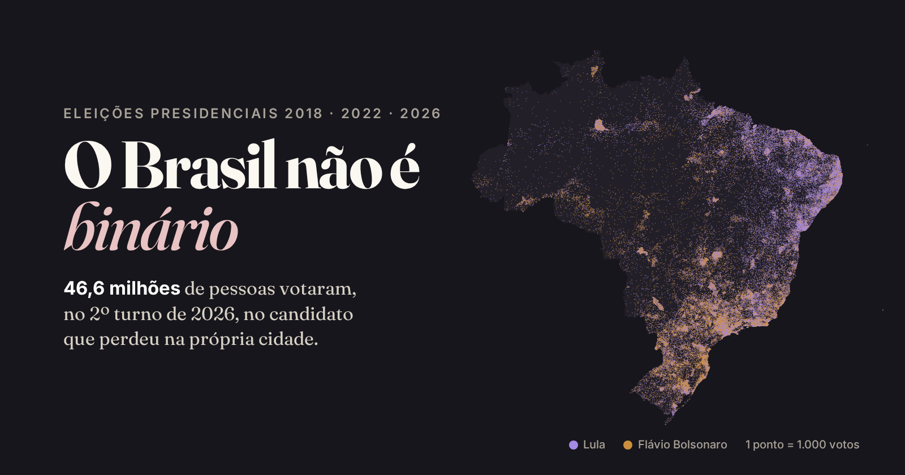

# Brazil is not binary



A data story about the Brazilian presidential elections of 2018, 2022 and 2026 (with 2014 as a baseline), built from official TSE and IBGE data, municipality by municipality. The "who won in each city" map draws a country split in two blocks. The votes say something else: both camps have voters everywhere, alongside people who voted for someone else, voted blank or null, or stayed home.

* **Site:** https://andreilud.github.io/brasil-nao-e-binario/ (Portuguese)
* **Versão em português deste README:** [README.pt-BR.md](README.pt-BR.md)

## Key findings

All figures come from `docs/data/facts.json`, which the pipeline computes; this README is rendered from a template, so no number is typed by hand. 2026 runoff unless noted.

* **46.6 million people voted for the candidate who lost in their own municipality**, 37.6% of all valid votes.
* **The winner map hides a tie.** Lula led in 2,875 municipalities and Flávio Bolsonaro in 2,695. 37.9% of Lula's votes in Brazil came from municipalities that Flávio won, and 37.4% of Flávio's from municipalities that Lula won.
* **The local loser rarely disappears.** It got more than 30% of the vote in 3,554 municipalities and more than 10% in 5,558 of 5,571. In the most lulista municipality, Carnaubeira da Penha (PE), Flávio got 7.7%; in the most bolsonarista, Nova Pádua (RS), Lula got 9.4%.
* **Each camp has millions of votes where it loses.** Flávio got 10.8 million votes in the Northeast, more than in 11 federative units of other regions combined. Lula got 6.8 million in the South, more than in 11 units of other regions combined. In the North the two were 1,079 votes apart.
* **Against the thesis, shown with the same weight.** Region and income are strongly associated with the municipal vote. Lula led 1,774 of the 1,794 Northeast municipalities; Flávio led 1,054 of 1,191 in the South. The median lulista share was 76.4% in the lowest income band and 31.9% in the highest (correlation with log median income: −0.83).
* **2018.** The runoff share of the candidate facing the PT (Aécio in 2014, Bolsonaro in 2018) grew in 3,830 of 5,570 municipalities: by 9.2 points in the Southeast, 9.4 points in the South and 2.0 points in the Northeast.
* **2022.** Lula had 13.3 million more runoff votes than Haddad; the Southeast accounted for 58.9% of that gain inside Brazil.
* **2026 turnaround.** Flávio led the first round by 2.2 million votes and Lula won the runoff by 4.4 million. Between rounds Lula gained 10.4 million votes and Flávio 3.7 million; Lula grew more than Flávio in 5,230 municipalities and Flávio more than Lula in 340.

## Questions

1. How did the national result evolve from 2018 to 2026, in both rounds, including abstention, blank and null votes?
2. How did each municipality vote in each election and round?
3. How mixed is the vote (distribution of municipal shares, municipalities where the local loser got more than 30% or 40%, absolute votes by region)?
4. Where and how much did the bolsonarista camp grow in 2018, compared with the non-PT side of 2014?
5. Where did the lulista camp regain ground in 2022?
6. How did the 2026 runoff turnaround happen, and how is it associated with third-candidate votes and turnout change?
7. How is the vote associated with municipality size, region and income?

Each question has one SQL file in `sql/` (`q1_national.sql` to `q7_context.sql`).

## Camps

To compare elections with different candidates, votes are grouped into two camps:

* **Lulista camp:** Fernando Haddad (2018), Lula (2022 and 2026).
* **Bolsonarista camp:** Jair Bolsonaro (2018 and 2022), Flávio Bolsonaro (2026).
* **2014** (Dilma Rousseff against Aécio Neves) is only a baseline and is always labelled with the candidates' names.

## Data sources

| Data | Source |
|---|---|
| Votes by candidate, municipality and zone | [TSE open data](https://dadosabertos.tse.jus.br/), `votacao_candidato_munzona_<year>.zip` (presidential member `_BR.csv`) |
| Turnout, abstention, blank and null votes | TSE, `detalhe_votacao_munzona_<year>.zip` |
| TSE to IBGE municipality codes | TSE, `municipio_tse_ibge.zip` (checked against the Base dos Dados municipality directory) |
| Official totals for validation | TSE totalization reports (2018, 2022, 2026) and the 2026 results portal |
| Municipal boundaries | IBGE, Malha Municipal 2025 |
| Region, UF | IBGE localidades API |
| Population, income | IBGE Censo 2022 (SIDRA tables 4709 and 10295) |

Exact URLs, file sizes, checksums and retrieval times are recorded in `data/raw/manifest.json` after a run.

## Method in short

* The TSE files are read with DuckDB and summed from zones to municipalities (`sql/00_staging.sql`, `sql/01_model.sql`).
* For every municipality and round, five groups add up exactly to the electorate: lulista camp, bolsonarista camp, other candidates, blank or null, and did not vote.
* Votes cast abroad count in national totals and are left out of maps.
* **Validation:** every national, state and abroad total of every round was compared cell by cell with the official TSE totals (3,625 cells, 0 unexplained differences). See `project_docs/quality_log.md`.
* **Map:** the IBGE mesh is projected (Albers equal-area), simplified as a coverage so neighbours keep shared borders, and exported as TopoJSON. The dot map places one dot per 1,000 votes at a random spot inside its municipality, with a fixed seed.

Details, decisions and their reasons: [project_docs/methodology.md](project_docs/methodology.md). Column definitions: [project_docs/data_dictionary.md](project_docs/data_dictionary.md).

## Limitations

* Municipal data describe places, not people. No number here says how an individual voted (ecological fallacy). Associations with income, size, third candidates or turnout are not causal.
* Abstention includes outdated registrations (people who moved or died).
* The 2014 comparison measures the candidate who faced the PT in the runoff, not the same political movement.
* No independent official source for 2014 totals was reachable; 2014 was checked against the TSE section-level file, which comes from the same database.
* Boa Esperança do Norte (MT) was installed in 2025 with parts of Sorriso and Nova Ubiratã and had its first presidential election in 2026, so the 2026 results of those two municipalities cover a smaller area than in earlier years.

## Reproduce

Requirements: Python 3.12 and about 1 GB of free disk space. One command runs everything (downloads only what is missing):

```bash
python3.12 -m venv .venv
.venv/bin/pip install -r requirements.txt
.venv/bin/python run_all.py          # download, clean, validate, analyse, export, render
.venv/bin/python -m src.vendor       # optional: re-download pinned JS libraries and fonts
.venv/bin/python -m playwright install chromium
.venv/bin/python -m src.screenshots og   # optional: regenerate the share image
.venv/bin/python -m src.smoke            # browser smoke test (no JS errors, controls, search, deep link)
cd docs && python3 -m http.server 8000   # open http://localhost:8000
```

`make all`, `make serve` and `make screenshots` do the same. Versions are pinned in `requirements.txt`. DuckDB is pinned to version 1.5.6 on purpose: the 2.0 wheels require AVX instructions that some virtual machines do not have. Raw data are not versioned (`data/raw/` is ignored); `src/download.py` fetches them again and records checksums.

## Repository structure

```
run_all.py            one command for the whole pipeline
requirements.txt      pinned Python dependencies
sql/                  one SQL file per question, plus staging, model and validation
src/                  download, crosswalk, checks, validation, geo, export, facts, render
src/templates/        page, READMEs and methodology templates (numbers come from facts.json)
notebooks/            exploratory analysis with questions and takeaways (executed)
project_docs/         brief, data dictionary, quality log, methodology
data/raw, interim     not versioned
data/processed/       analysis tables (CSV), validation results
docs/                 the site (GitHub Pages)
```

## Publish with GitHub Pages

1. `SITE_URL` and `REPO_URL` in `src/config.py` hold the public addresses (the share image needs an absolute URL); after changing them, run `.venv/bin/python -m src.render`.
2. On GitHub: **Settings → Pages → Build and deployment → Source: Deploy from a branch → Branch: main, folder: /docs → Save.**

## Credits

Code: MIT License (see `LICENSE`). Data: Tribunal Superior Eleitoral (TSE) and Instituto Brasileiro de Geografia e Estatística (IBGE). Libraries: D3 (ISC), topojson-client (ISC), Scrollama (MIT). Fonts: Fraunces and Inter (SIL Open Font License). License files are in `docs/vendor` and `docs/fonts`.
